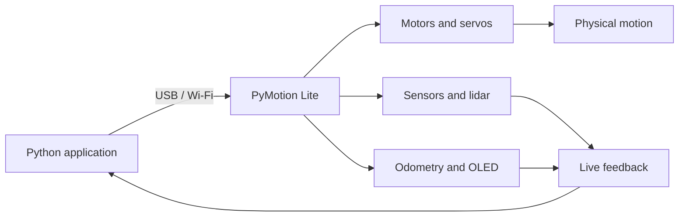

<div align="center">

<a href="README.md"></a>&nbsp;&nbsp;<a href="README_CN.md"></a>

<h1>PyMotion Lite</h1>

<p><strong>Take Python beyond the screen.</strong></p>
<p>From code to motion, and from motion back to data—a Python-native controller for robotics learning, rapid prototyping, and intelligent hardware.</p>

<p>
  <a href="https://pymotion.mintlify.site"></a>&nbsp;
  &nbsp;
  &nbsp;
  
</p>

</div>

PyMotion Lite brings DC motors, PWM servos, TTL bus servos, sensors, lidar, odometry, OLED output, and device status into one consistent `pm.lite` API. Start with USB for dependable bench testing, then move to Wi-Fi for untethered robots without changing the way your application is structured.



## Why PyMotion Lite

| Feature | What it gives you |
| --- | --- |
| Python-native API | Work with real device capabilities without first implementing low-level protocols |
| Control plus feedback | Send motion targets and read encoders, measured speed, sensors, power, and device status |
| One API for USB and Wi-Fi | Move from desk-side development to mobile and wireless projects smoothly |
| Real-time workflows | Stream multiple data sources while continuously updating actuator targets |
| Safety in the normal workflow | Token authentication, control ownership, command expiry, explicit stop, and clean shutdown |
| Offline installation | Install the SDK and dependencies from local wheels into an isolated Python environment |

## Environment

- Ubuntu 24.04 LTS on 64-bit x86_64 / amd64.
- The installer uses system CPython 3.12 to create an isolated environment; no Python packages are downloaded during SDK installation.
- Run setup as a normal user with `sudo` access for USB permissions; do not run the setup script directly as root.
- Visual Studio Code is recommended; the SDK environment also works without VS Code.
- USB connections require a data-capable USB cable.

## Quick start

Open the [PyMotion Lite Ubuntu SDK repository](https://github.com/PyMotion-OS/PyMotion_Lite_Ubuntu), then select **Code → Download ZIP** to download the SDK.

Extract the complete SDK package to a short path, for example `~/PyMotion_Lite_Ubuntu`.

### 1. Prepare the SDK folder

Open a terminal and enter the SDK root:

```bash
cd ~/PyMotion_Lite_Ubuntu
```

The folder must include at least:

```text
PyMotion_Lite_Ubuntu/
├── setup-ubuntu.sh
├── open-sdk-vscode.sh
├── run-sdk-python.sh
├── install-udev.sh
├── examples/
├── internal/
└── wheels/
```

Keep the complete folder structure. Do not copy an installer by itself, or move, remove, or modify `internal`, `wheels`, or `examples`.

### 2. Install the SDK

Run setup as your normal user:

```bash
bash ./setup-ubuntu.sh
```

The script verifies bundle integrity, creates an isolated environment, installs the SDK and dependencies from local wheels, configures the udev rule, and prepares an editable example workspace. The default SDK environment is:

```text
~/.local/share/pymotion-lite/venv-ubuntu
```

When setup finishes, follow the terminal prompt to disconnect and reconnect the PyMotion Lite USB cable. If setup added your user to the `dialout` group, log out of the Ubuntu session completely and log in again once.

### 3. Open the SDK workspace

From the SDK root, run:

```bash
bash ./open-sdk-vscode.sh
```

The launcher checks the installed SDK, copies examples to an editable workspace under your user profile, selects the correct Python interpreter, and opens a new VS Code window.

Without VS Code, run examples with the SDK environment directly:

```bash
~/.local/share/pymotion-lite/venv-ubuntu/bin/python \
  ./examples/quick-start/01-pymotion-lite.py
```

### 4. Connect your PyMotion Lite board

Attach a data-capable USB cable and make sure the board is powered normally. Then set the board's current Token in the VS Code terminal:

```bash
export PYMOTION_AUTH_TOKEN="your device Token"
```

After connecting USB and setting the Token, run the read-only connection example:

```bash
python ./examples/quick-start/02-connection.py
```

This example only establishes a USB connection, reads the board status, and closes the connection. It does not drive motors or servos. A successful run prints output similar to:

```text
PyMotion Lite SDK: 1.0.1
Device ID: ...
Transport: usb
State: ...
Status age: ... s
```

Once you see the device ID, `Transport: usb`, and board status, the SDK is communicating with PyMotion Lite correctly. Continue with the other examples under `examples/quick-start` or follow the numbered lessons in `examples/lite-learning-course`.

Without VS Code, run the same example from the SDK root with the isolated environment:

```bash
export PYMOTION_AUTH_TOKEN="your device Token"
~/.local/share/pymotion-lite/venv-ubuntu/bin/python \
  ./examples/quick-start/02-connection.py
```

## Where to go next

| Goal | Start here |
| --- | --- |
| Learn the SDK and make the first connection | [Quick Start](examples/quick-start) |
| Learn motors, servos, sensors, and real-time control | [Lite Learning Course](examples/lite-learning-course) |
| Check the SDK environment | `~/.local/share/pymotion-lite/venv-ubuntu/bin/pymotion doctor` |
| Look up features, APIs, and safety constraints | [Online User Manual](https://pymotion.mintlify.site) |

> [!CAUTION]
> Wire motors and servos only while power is disconnected. Use a suitable external actuator supply, lift wheels off the work surface, and clear the mechanism's full range of motion. Software stops and communication timeouts do not replace an immediately accessible physical power disconnect.

